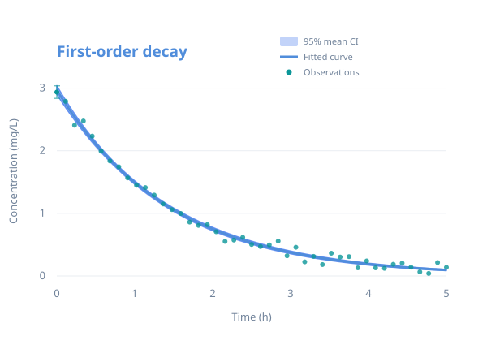

<div class="cf-hero" markdown>
<div class="cf-hero-copy" markdown>
<span class="cf-eyebrow">SCIENTIFIC PYTHON · v0.1.0</span>

# A fit is only<br>the beginning.

Turn nonlinear model fits into interpretable uncertainty.
Confidence bands, likelihood diagnostics, shared experiments and errors in
both axes — with the assumptions in view.

[Get started](quickstart.md){ .md-button .md-button--primary }
[Explore the API](reference/index.md){ .md-button }

<div class="cf-hero-meta">NumPy + SciPy · Typed · MIT licensed</div>
</div>
<figure class="cf-hero-figure">
  
  <figcaption>Fit the process. Understand the uncertainty.</figcaption>
</figure>
</div>

<div class="cf-proof-strip">
  <span><strong>10</strong> focused features</span>
  <span><strong>2</strong> functional modules</span>
  <span><strong>11</strong> reproducible workflows</span>
</div>

## Built for interpretable science

<div class="grid cards" markdown>

- **Quantify uncertainty**

    Separate uncertainty in a fitted mean from the noise of a future observation.
    Use local covariance, profile likelihood or residual resampling deliberately.

    [Fit to uncertainty →](tutorials/fitting.md)

- **Connect experiments**

    Fit unequal datasets together with one optimized degree of freedom for each
    shared parameter. Derive covariance from the joint Jacobian.

    [Shared-parameter fitting →](tutorials/global.md)

- **Respect measurement error**

    Account for uncertainty in both predictors and responses with SciPy ODR,
    while preserving its distinct statistical interpretation.

    [Errors in both axes →](tutorials/eiv.md)

- **Keep assumptions visible**

    Read the noise model, reference law, numerical limits and failure behavior
    alongside the calculation. No uncertainty estimate is assumption-free.

    [Statistical concepts →](user-guide.md)

</div>

## Your model. Ordinary NumPy arrays.

```python
import numpy as np
from scipy.optimize import curve_fit
from curvefit_stats import generate_error_bands

def decay(time, amplitude, rate):
    return amplitude * np.exp(-rate * time)

time = np.linspace(0, 5, 45)
rng = np.random.default_rng(2026)
concentration = decay(time, 3.0, 0.7) + rng.normal(0, 0.08, time.size)
popt, pcov = curve_fit(decay, time, concentration, p0=[2.5, 0.5])
grid = np.linspace(0, 5, 101)
lower, upper = generate_error_bands(
    decay, grid, popt, pcov, concentration, x_fit=time,
)
assert lower.shape == upper.shape == grid.shape
```

These are approximate **pointwise 95% mean confidence intervals** under an unknown
common Gaussian variance. They are not simultaneous bands or prediction intervals.
[Continue the quickstart](quickstart.md) to make those distinctions explicit.

!!! note "Install from source"

    The release candidate is installable from the repository. These docs do not
    imply a PyPI publication. See [installation](installation.md) for supported
    versions and the [verification record](release-readiness.md) for checks executed.

## Find your next step

| Goal | Start here |
| --- | --- |
| Install and fit a first model | [Installation](installation.md) · [Quickstart](quickstart.md) |
| Choose an inference method | [Workflow guide](workflows.md) |
| Understand variance, likelihood and identifiability | [Statistical concepts](user-guide.md) |
| Run a complete scientific example | [Eleven executable examples](examples.md) |
| Look up arguments, returns and exceptions | [Source-generated API](reference/index.md) |
| Contribute or inspect scientific validation | [Development](development.md) · [Scientific review](review.md) |
